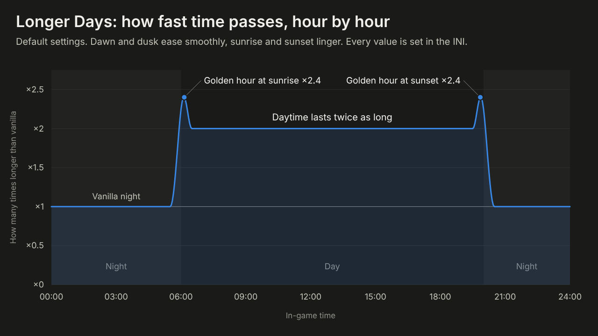

# Crimson Desert – Longer Days

Makes the day in Crimson Desert last longer. Instead of one fixed speed for the
whole clock, it shapes the day:

- **Separate day and night speeds.** By default daytime lasts 2× as long and
  night is vanilla.
- **Smooth dawn and dusk.** The speed eases between night and day over a
  configurable window instead of jumping at a set hour.
- **Golden hours.** Sunrise and sunset last longer, slowing most at the exact
  moment and less on either side.
- **Real-minute targets.** Write "daytime lasts 90 real minutes" instead of
  working out a multiplier. The mod measures the game's own clock speed while
  you play, so the target stays accurate after a patch.
- **Seasons (optional).** Days are longer in summer and shorter in winter
  across the in-game year. The defaults roughly line up with
  *Seasons of Pywel*.
- **Sky stays in sync.** The sun, moon and sky follow the slowed clock.
- **Live tuning.** Save the INI in-game and changes apply within a second. F8
  switches between this mod and vanilla.
- **Hourly log.** The log shows how much time is slowed each in-game hour and
  why.

Only the clock slows down. Combat, physics, AI and animation run at normal
speed.

Nexus Mods page materials (description, summary, images, publishing checklist)
are in [`nexus/`](nexus/PUBLISHING.md).



> **Status: untested in-game (v0.2.0).** The game logic is unit-tested, but the
> hook has not been run in the game yet. It uses signatures that were confirmed
> in game build **2.03.00**. If your build differs, the log says so. Single-player
> only.

## Install

1. Install **Ultimate ASI Loader** (x64) by putting its `winmm.dll` in
   `Crimson Desert\bin64\`. Skip this if your mod manager already includes an
   ASI loader.
2. Copy `CrimsonDesertLongerDays.asi` and `CrimsonDesertLongerDays.ini` into
   `Crimson Desert\bin64\`.
3. Start the game. `CrimsonDesertLongerDays.log` appears next to the `.asi` and
   should contain `Ready.`

**Getting the files:** download the zip from the
[Releases](https://github.com/La2o/CrimsonDesert-LongerDays/releases) page (or
the Nexus page, once it's up) and extract it into the Crimson Desert folder.
Development builds are under **Actions → Build → latest run → Artifacts**.

**Uninstall:** delete the `.asi` and `.ini`. Game files and saves are never
touched.

## Settings

All settings are in `CrimsonDesertLongerDays.ini`, and every key is explained in
the file. Some combinations:

| You want… | Set |
| --- | --- |
| Days twice as long (default) | `DayLengthMultiplier=2` |
| Whole cycle 3× slower | `DayLengthMultiplier=3`, `NightLengthMultiplier=3` |
| Long days, quick nights | `DayLengthMultiplier=2.5`, `NightLengthMultiplier=0.5` |
| Day lasts 2 real hours, night 20 min | `[RealTime]` `DayRealMinutes=120`, `NightRealMinutes=20` |
| Long sunsets for screenshots | `[GoldenHour]` `Multiplier=4`, `LengthHours=1.5` |
| Long summer days, short winter days | `[Seasons]` `Strength=0.4` |
| Vanilla, but with smooth golden hours | `DayLengthMultiplier=1`, `[GoldenHour]` `Multiplier=2` |

## How it works

At every moment the mod works out how much slower the clock should run:

```
speed = blend(night, day × season, dawn/dusk curve) × golden-hour bump
```

- **The day/night blend** uses a smoothstep curve centred on `DayStartHour` and
  `DayEndHour`.
- **The golden hour** is a raised-cosine bump at sunrise and sunset.
- **The season** is a cosine over the in-game year.

This math is in [`src/schedule.cpp`](src/schedule.cpp). It doesn't depend on the
game, and [`tests/tests.cpp`](tests/tests.cpp) tests it.

To apply the speed, the mod changes two parts of the game:

1. **The field clock.** Each frame, a tick function adds the frame time to the
   accumulator that the `{day, hour, minute, second}` clock comes from. The mod
   hooks the tick and divides the frame time by the current speed.
2. **The visible sun.** The render-side TimeOfDay manager moves the sun on its
   own separate accumulator. The mod pins its `[lower, upper]` time limit to the
   field clock's hour every frame, so the sun follows the slowed clock. The
   original limits are restored when the mod is turned off.

**Measuring the clock speed.** The mod keeps two running totals: the tick time
it handed to the game, and the in-game seconds that passed. After every 10
in-game minutes, the ratio of the two gives the vanilla clock speed. If the
clock jumps by more than any real speed could explain (sleeping, waiting,
loading), the measurement window starts over. See
[`src/rate_meter.cpp`](src/rate_meter.cpp).

**Finding the game code.** All game-specific knowledge is in
[`src/offsets.h`](src/offsets.h), as byte signatures that are scanned when the
game loads. There are no fixed addresses. The scanner
([`src/pattern.h`](src/pattern.h)) finds each signature's longest fixed run with
Boyer-Moore-Horspool, then checks the wildcards only where that run matches.

## Troubleshooting

Check `bin64\CrimsonDesertLongerDays.log`:

- **No log:** the ASI loader isn't loading the mod. Check the loader DLL and
  that both files are in `bin64`.
- **`field-time tick signature NOT FOUND`:** a game update changed the code, and
  the signatures in `src/offsets.h` need updating. A second log from the
  launcher with this error is harmless.
- **`time-of-day engine signature NOT FOUND`:** the clock still slows down, but
  the sky moves at vanilla speed.
- **Conflicts:** don't use it with other mods that change day/night speed or
  freeze time of day, such as Timescale or trainer "freeze time" options. They
  change the same values.

## Building

```sh
# The mod (Windows, Visual Studio 2022 x64 or MinGW-w64). MinHook is fetched automatically.
cmake -S . -B build -A x64
cmake --build build --config Release        # -> build/Release/CrimsonDesertLongerDays.asi

# Unit tests (any OS)
cmake -S . -B build-tests -DLONGERDAYS_TESTS=ON
cmake --build build-tests && ctest --test-dir build-tests
```

## Credits

- The signatures and offsets for the game's clock and time of day come from the
  open-source [Trinity](https://github.com/XeTrinityz/Trinity) by XeTrinityz
  (MIT). Everything else here was written for this mod.
- Hooking: [MinHook](https://github.com/TsudaKageyu/minhook).

Not affiliated with or endorsed by Pearl Abyss.
